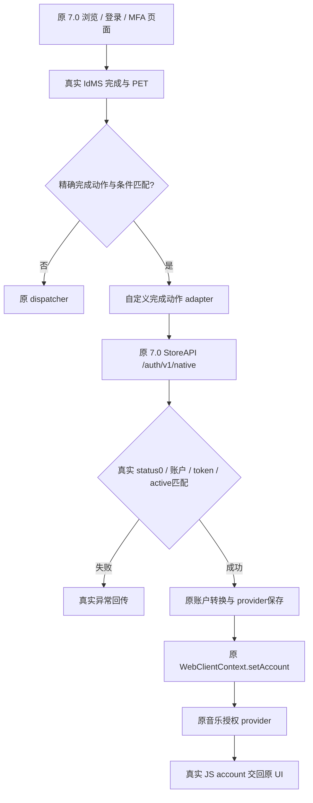

# 34/35 架构与版本绑定

源码：[FinalAccount.java](../src/com/e8/auth36/FinalAccount.java) 和 [Completion.java](../src/com/e8/auth36/Completion.java)。对原 ActionJSInterface.postMessage 只插入 route 调用；见 [接入补丁](../patches/final-action-hook.smali) 与 [严格补丁工具](../tools/patch_ui.py)。没有复制整份 Apple smali。

route 只接受 run、精确 AMSIDMSAuthenticationCompleteAction、真实 username/PET、makeCurrentAccount/canMakeAccountActive 为真、ignoreAccountConversion 为假且无额外 HTTP headers。其他请求原样交回原流程；注册失败也回退原流程，不能把回退等同于兼容认证成功。

运行时注册 E8AuthenticationCompleteAction，保留原 dispatcher、事件封装和 IWebAction 合约。工作线程等待原协程；调用 hi.c.intercepted 保留调用方调度语义；90 秒等待超时是真实失败。不会把 UI 看起来消失当成结果。

`Gb.b`、`e7.e`、`B9.h/f`、`hi.c` 等都是 **7.0.0/1614 混淆版本绑定**，反射方法选择依赖参数类型；升级必须逐个核实。`Completion` 的 hi/fi/Kotlin 编译占位定义不能打包成宿主类型替代物。

34 内嵌 classes2/3/4 未变；classes.dex 加入 UI route，classes5 是关闭诊断弹窗的既有辅助 DEX，classes6 为最终 adapter。后两项不能仅用本仓库 Java 编译替代整个基线。AM++ 模块与音频原生库保持既有字节。
