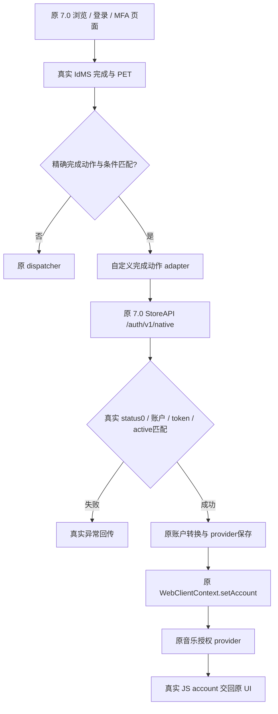

# 当前架构与版本绑定

当前交付39沿用34认证实现与35压缩方式；36修改宿主/模块界面DEX，37修改宿主设置列表，38替换内外层启动图标资源，39只修改AM++播放器几何。下文描述34引入并沿用至39的认证架构。

源码：[FinalAccount.java](../src/com/e8/auth36/FinalAccount.java) 和 [Completion.java](../src/com/e8/auth36/Completion.java)。对原 ActionJSInterface.postMessage 只插入 route 调用；见 [接入补丁](../patches/final-action-hook.smali) 与 [严格补丁工具](../tools/patch_ui.py)。

route 只接受 run、精确 AMSIDMSAuthenticationCompleteAction、真实 username/PET、makeCurrentAccount/canMakeAccountActive 为真、ignoreAccountConversion 为假且无额外 HTTP headers。其他请求原样交回原流程；注册失败也回退原流程，不能把回退等同于兼容认证成功。

运行时注册 E8AuthenticationCompleteAction，保留原 dispatcher、事件封装和 IWebAction 合约。工作线程等待原协程；调用 hi.c.intercepted 保留调用方调度语义；每次Await最多等待90秒；这不是整个登录流程的总超时。

`Gb.b`、`e7.e`、`B9.h/f`、`hi.c` 等都是 **7.0.0/1614 混淆版本绑定**，反射方法选择依赖参数类型；升级必须逐个核实。`Completion` 的 hi/fi/Kotlin 编译占位定义不能打包成宿主类型替代物。

## 各版本的修改范围

以下均相对于各自输入基线，不能跨版本理解为同一文件始终未变。

| 版本 | 修改范围 |
|---|---|
| 34 | classes.dex加入UI route，classes6为最终adapter；沿用classes5辅助DEX，classes2/3/4及AM++模块保持当时基线内容 |
| 35 | 只调整外层压缩、对齐与签名，解压内容与34一致 |
| 36 | 宿主classes2.dex修复歌单按钮；AM++模块classes2.dex调整播放器 |
| 37 | 宿主classes3.dex隐藏均衡器入口，保留36模块 |
| 38 | 内外层resources.arsc与新增日夜图标PNG，保留37所有DEX和模块 |
| 39 | AM++模块classes2.dex调整播放器尺寸，宿主origin.apk及队列逻辑不变 |

34–39未新增音频原生库修改。完整基线还含早期兼容接入，不能只编译认证Java文件替代全部应用内容。
