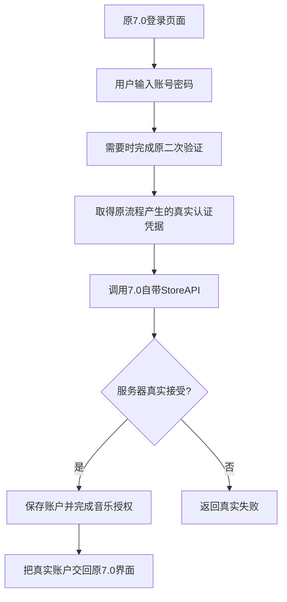

# 五分钟看懂这个项目

[返回首页](../README.md) · 下一篇：[维护与代码导读](code-guide.md)

## 最初要做什么

在银河E8上运行Apple Music7.0，使用AM++的大屏双栏：左边封面和播放控制，右边歌词。希望仍能在线登录、使用订阅听歌，操作保持原应用的样子。

这不是从零开发一个播放器，而是在既有应用上做兼容适配。

## 为什么做了这么多轮

前后遇到的是几类不同的问题，并非一个错误反复修了35遍。

| 阶段 | 用户看到什么 | 实际在解决什么 |
|---|---|---|
| 前期 | Root设备被拦、横屏不合适 | 启动检测、合入AM++、布局与菜单 |
| 前期 | 首页提示蜂窝数据关闭 | 应用内网络许可判断；与整机断网分开 |
| 09–17 | 输入后登录弹框消失 | 追出原生认证失败链，并独立测试系统DRM |
| 18–30 | 旧4.9.5能登录，新7.0失败 | 找另一条真实认证路径，验证账户能否被新版使用 |
| 31–33 | 有额外组件、跳转或旧登录页 | 这些方案不符合原7.0体验，最终放弃 |
| 34 | 需要独立安装且保留原界面 | 只适配最后的账户交接，不再依赖4.9.5包 |
| 35 | ARM64包仍很大 | 修正压缩方式，功能内容保持一致；用户实车测试成功 |
| 36 | 歌单按钮裁切、播放器控件布局 | 修复绘制密度并调整播放器布局 |
| 37 | 不需要应用内均衡器入口 | 隐藏入口，保留音频处理状态 |
| 38 | 需要日夜图标 | 使用182×104原图，按系统night资源选择 |

“35轮”包括工具、静态调查和实验，并不代表35个正式发布版。早期部分编号对应资料不完整，历史文档已标明。

## 新版原来为什么失败

账号密码步骤之后，原认证还会要求设备身份签名。实车记录显示，这条路径进入Full模式，Widevine challenge失败，随后setup请求返回HTTP500，签名为空，最后登录失败并关闭弹框。

可以把它理解为：**输入通过了前面的步骤，但后面的设备身份认证没有完成。** 所以只改弹框关闭逻辑不会让账户登录成功。

这不代表已经解释了服务器500的全部原因，也不代表这台车永远不支持Widevine；项目没有通过伪造签名或强制成功来处理。

## 最终34版怎样解决

调查发现，7.0内部还保留另一条原装登录接口。关键是要给它原登录流程产生的正确认证凭据，而不是随意换一个函数或直接重用旧密码请求。

这里没有安装4.9.5，也没有把4.9.5的SO塞进7.0。旧版帮助我们验证方向，最终实现调用的是7.0本身保留的接口。AM++继续负责双栏等界面增强。

## 现在使用哪个版本

最新交付是38，包含34的独立认证、35的压缩和36–38的界面更新。34/35保留作历史对照；各版本包名和签名一致，覆盖安装切换。宿主仍是Apple Music7.0.0/1614，项目序号不代表Apple官方版本号。

35已经获得用户实车播放/歌词成功反馈。36修复播放器和歌单按钮，37隐藏均衡器入口，38增加日夜图标，各项验证见 [验证矩阵](testing.md)。

## 接下来你只需要关注什么

想回顾过程，看 [迭代经过](history.md)。想继续改功能或页面，看 [维护与代码导读](code-guide.md)。遇到Bug，先看 [已知问题](known-issues.md) 是否已有记录，再描述“在哪个页面、做了什么、出现什么”。不用先读懂所有认证术语。

独立登录和35实车使用已取得成功记录。当前问题、专项验证和历史现象集中维护在 [状态清单](known-issues.md)，避免把早期失败继续当作最新版故障。
